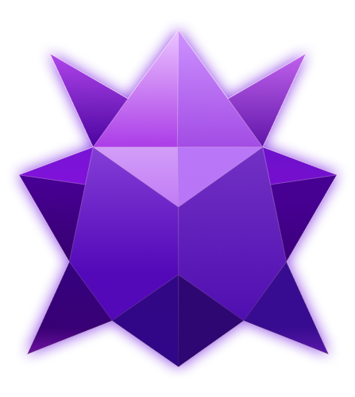
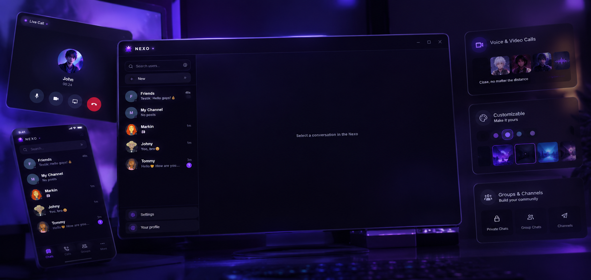
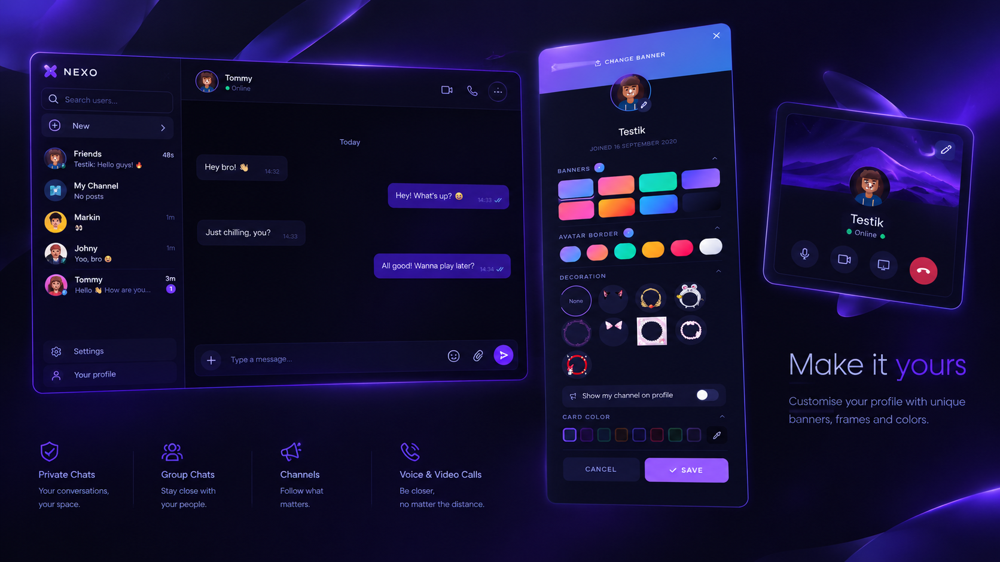
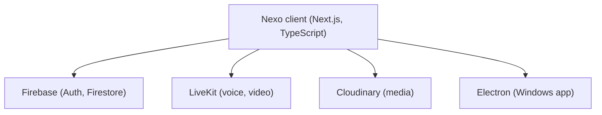

<div align="center">



# Nexo

Real-time communication platform with messaging, channels, voice and video calls, and a native desktop client.

[](https://github.com/m1tywaflow/chat/stargazers)
[](https://github.com/m1tywaflow/chat/network/members)
[](https://github.com/m1tywaflow/chat/blob/main/LICENSE)

[Live Demo](https://chat-vert-nu-34.vercel.app/)

</div>

---

## Overview

Nexo is a full-stack communication platform that combines private and group messaging, public channels, voice and video calls, profile customization, and a Windows desktop application. Conversations and user state are synchronized in real time, and the interface relies on optimistic updates to stay responsive.

<div align="center">



<br /><br />



</div>

## Features

### Messaging

- Private and group conversations
- Real-time message synchronization
- Message editing, deletion, and forwarding
- Replies and pinned messages
- Emoji reactions
- Read receipts and unread indicators
- Voice messages
- Image and media sharing

### Channels

- Public channels with posts and discussions
- Subscriber management
- Reactions and view counters
- Pinned posts
- Content forwarding and media sharing

### Voice and Video

- Voice and video calls powered by LiveKit
- Call controls
- Conversation-based calls

### Profiles and Themes

- Custom avatars, banners, decorations, and colors
- Collectible gifts
- Dark, light, and custom themes

### Desktop Client

- Native Windows application built with Electron
- Desktop notifications
- Automatic updates via GitHub Releases
- NSIS installer
- Secure IPC communication

## Tech Stack

| Category         | Technology                |
| ---------------- | ------------------------- |
| Framework        | Next.js (App Router)      |
| Language         | TypeScript                |
| Styling          | Tailwind CSS v4           |
| State management | Zustand                   |
| Database         | Cloud Firestore           |
| Authentication   | Firebase Auth             |
| Voice and video  | LiveKit                   |
| Media            | Cloudinary                |
| Desktop          | Electron                  |
| Packaging        | electron-builder, NSIS    |
| Deployment       | Vercel                    |

## Architecture

- **Firebase** provides authentication and Firestore-based real-time synchronization of conversations and user state.
- **LiveKit** handles real-time voice and video communication.
- **Cloudinary** handles media storage, processing, and delivery.
- **Electron** wraps the web client into a Windows desktop application.



## Project Structure

```text
src/
├── app/
├── components/
├── hooks/
├── lib/
├── stores/
└── types/

electron/
└── main.js

public/
└── logo.png
```

| Path                | Purpose                                      |
| ------------------- | -------------------------------------------- |
| `src/app`           | Next.js routes and pages                     |
| `src/components`    | UI components                                |
| `src/hooks`         | React hooks                                  |
| `src/lib`           | Firebase, LiveKit, and utility logic         |
| `src/stores`        | Zustand stores                               |
| `src/types`         | TypeScript types                             |
| `electron/main.js`  | Electron main process                        |

## Getting Started

### Prerequisites

- Node.js and npm
- A Firebase project (Auth and Firestore)
- A LiveKit project
- A Cloudinary account

### Installation

```bash
git clone https://github.com/m1tywaflow/chat.git
cd chat
npm install
```

### Configuration

Create a `.env.local` file in the project root and provide your Firebase, LiveKit, and Cloudinary credentials.

### Development

```bash
npm run dev
```

The application is available at `http://localhost:3000`.

## Build

Production web build:

```bash
npm run build
```

Windows desktop installer:

```bash
npm run dist
```

## Roadmap

- [x] Private and group messaging
- [x] Channels
- [x] Voice and video calls
- [x] Profiles and customization
- [x] Themes
- [x] Windows desktop client with automatic updates
- [ ] Additional personalization features
- [ ] Additional desktop features
- [ ] Performance improvements

## License

Released under the [MIT License](LICENSE).
